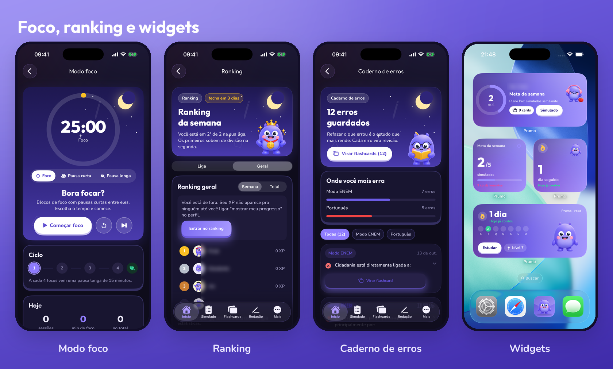
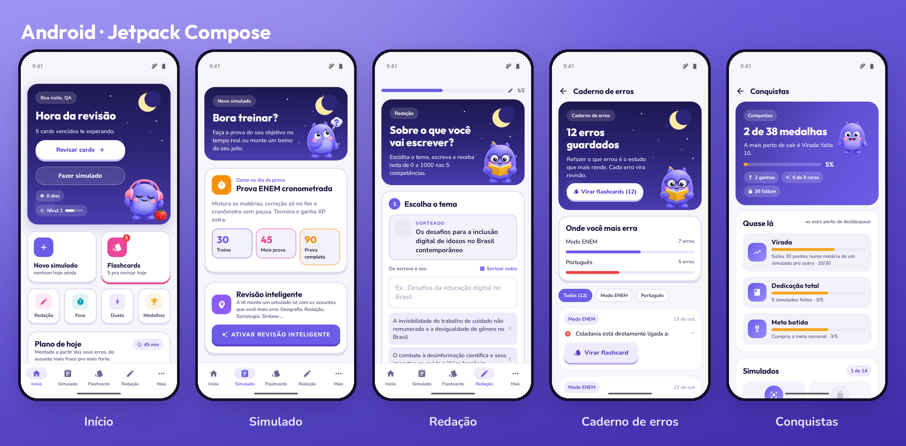
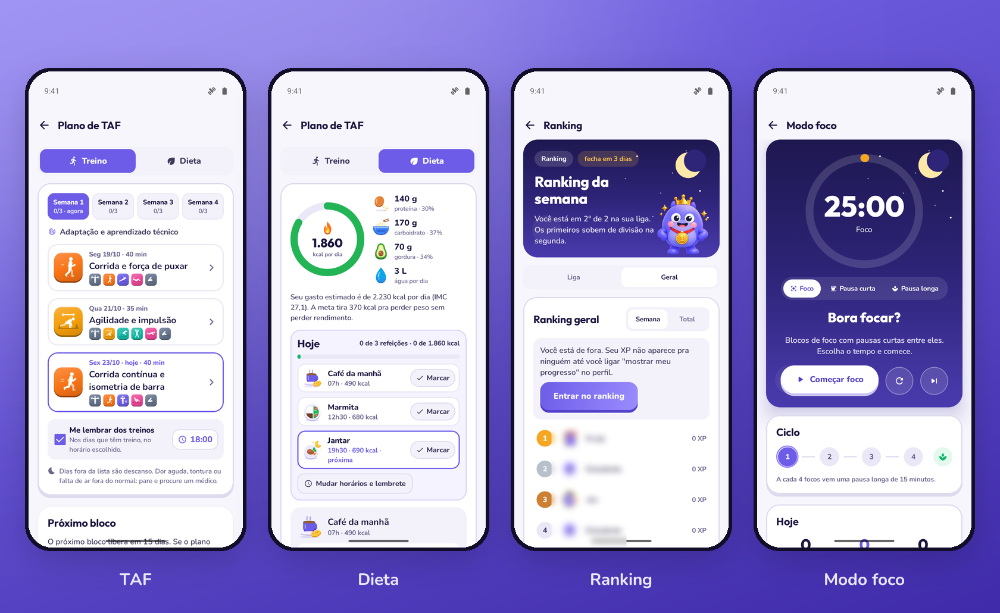
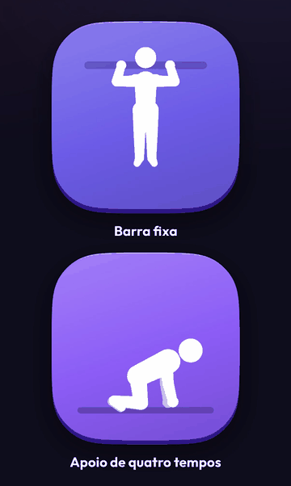

# Prumo para iOS e Android

Apps nativos da Prumo, plataforma de estudos com IA para ENEM e concursos.

[](https://estudeprumo.com)
[](https://estudeprumo.com)
[](https://estudeprumo.com)

Este repositório é um estudo de caso dos apps. O código-fonte é proprietário e não está aqui.
O estudo de caso da plataforma inteira (web, banco, infraestrutura) está em
[burnoutscript/prumo](https://github.com/burnoutscript/prumo).


## Por que app nativo

A Prumo nasceu na web, e o site funciona bem no celular. Mas quem estuda para prova estuda
um pouco todo dia, e o que faz a pessoa voltar amanhã é o lembrete na hora certa, o widget com
a sequência de dias na tela inicial e o cronômetro do foco aparecendo na tela de bloqueio.
Nada disso dá para fazer direito com um site.

Por isso os dois apps são nativos: Swift e SwiftUI no iPhone e no iPad, Kotlin e Jetpack
Compose no Android. Não usei React Native nem Flutter porque o que diferencia o app são
justamente as partes do sistema (WidgetKit, Live Activity, Glance, notificação local), e
nelas um framework cruzado acabaria exigindo código nativo de qualquer jeito.

| | |
|---|---|
| Status | Em testes internos. Publicação na App Store e na Google Play em breve |
| Plataformas | iPhone e iPad (iOS 17+), Android 8+ |
| Tamanho | Cerca de 13 mil linhas de Swift e 8,5 mil de Kotlin |
| Backend | O mesmo do site: Supabase (Postgres com RLS) e a API da Prumo |

## iOS


- SwiftUI, alvo iOS 17, projeto gerado pelo XcodeGen a partir de um `project.yml`, sem
  `.xcodeproj` versionado
- Login com Apple, com Google e com email, pelo SDK do Supabase
- Assinatura pelo StoreKit 2. O app manda a transação assinada para o servidor, que valida
  com a Apple e libera o plano. O app nunca decide sozinho quem é assinante
- Widgets de meta da semana, sequência de dias e treino do dia, inclusive na tela de bloqueio
- Live Activity do modo foco, com o cronômetro na Dynamic Island
- Funciona também no iPad



## Android



O app Android tem as mesmas telas e consome a mesma API que o iOS. Usa Kotlin, Jetpack
Compose, supabase-kt e widgets em Glance. A assinatura é feita pelo site, então não tem
Play Billing.



## TAF e dieta

Quem presta concurso policial ou militar precisa passar no teste físico (TAF), e cada edital
pede uma coisa diferente: tantas barras, tanto tempo na corrida, índice diferente para homem e
mulher. A Prumo monta o treino e a dieta a partir do edital do concurso do aluno.


Algumas decisões dessa parte:

#### A IA não faz conta

Os índices de 67 concursos ficam numa tabela gerada a partir dos editais, cada um com a
fonte. Gasto calórico, IMC e meta de calorias são calculados em código. A IA recebe esses
números prontos e só monta o treino da semana e o cardápio. Assim um erro do modelo nunca
vira uma meta de calorias errada.

#### Animação dos exercícios calculada no aparelho

Cada exercício é um esqueleto com poses-chave, e o app interpola as poses a 60 quadros por
segundo. Quadros prontos em vídeo pesariam muito e ficariam travados. O motor nasceu em
TypeScript no site e foi portado para Swift e para Kotlin. Os dois ports têm teste
automatizado contra uma referência gerada pela versão em TypeScript, então os três
desenham exatamente a mesma pose no mesmo instante.

<p align="center">
  
</p>

#### Treino guiado

O treino do dia roda tela a tela, com cronômetro de descanso, instrução de como fazer cada
exercício e um coach de voz que fala a próxima série. As refeições têm lembrete no horário
que o aluno escolher, por notificação local.

## Um backend, três clientes

```
   iPhone / iPad          Android              Web
   SwiftUI                Compose              Next.js
        │                    │                    │
        └──────────┬─────────┴─────────┬──────────┘
                   │                   │
         ┌─────────▼────────┐  ┌───────▼─────────┐
         │   API da Prumo   │  │    Supabase     │
         │ (token do usuário│  │ Auth · Postgres │
         │  em cada pedido) │  │   com RLS       │
         └─────────┬────────┘  └─────────────────┘
                   │
         ┌─────────▼────────┐
         │  Provedores LLM  │
         └──────────────────┘
```

Os apps falam com o banco direto só no que o Row Level Security protege, com a chave pública
e o token do próprio usuário. Tudo o que envolve IA, pagamento ou regra de negócio passa pela
API, que confere o token a cada pedido. Nenhuma chave privilegiada nem chave de modelo de IA
vai dentro do app, porque qualquer binário publicado pode ser aberto e lido.

## Como testo

- Build e testes rodam por linha de comando (`xcodebuild` e Gradle), sem depender da IDE aberta
- Os apps têm atalhos de depuração que só existem no build de debug: abrir direto numa tela,
  entrar com uma conta de teste, forçar um estado do treino. É assim que tiro os prints e
  confiro cada tela no simulador e no emulador, no tema claro e no escuro
- Os testes do motor de animação comparam cada pose com a referência do site

## Contato

Victor Candido, fundador e CEO da Prumo · [GitHub](https://github.com/burnoutscript) ·
[estudeprumo.com](https://estudeprumo.com)

<sub>Código-fonte proprietário. Este repositório contém apenas documentação pública do projeto.</sub>
